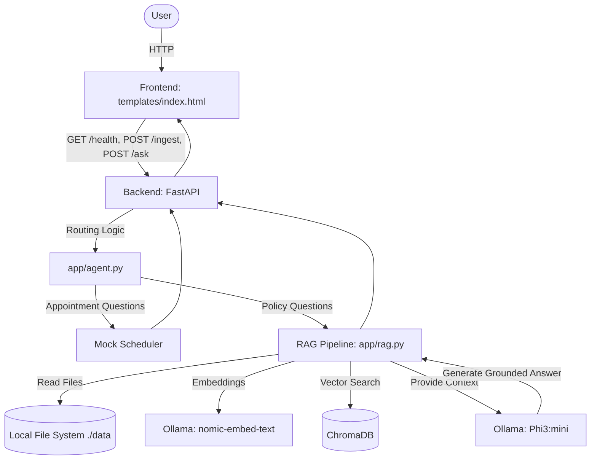

# Healthcare AI Assistant

This project is a submission for the **Mindbowser AI Engineer Hackathon Assignment**. It is a locally deployed, RAG-based AI assistant designed to answer healthcare-related queries securely using synthetic medical documents and strict prompt engineering.

---

## 1. Architecture Diagram



## 2. Setup Instructions

### Prerequisites
- Docker & Docker Compose
- Ollama installed locally

### Installation
1. Start Ollama locally and pull the required models:
   ```bash
   ollama pull phi3:mini
   ollama pull nomic-embed-text
   ```
2. Clone this repository and navigate to the project root.
3. Start the application using Docker:
   ```bash
   docker compose up --build
   ```
4. Access the web interface at `http://localhost:8000/`.

---

## 3. API Examples

### GET `/health`
Check if the API is running.
```bash
curl -X GET http://localhost:8000/health
```

### POST `/ingest`
Process and vectorize the text documents in the `data/` folder.
```bash
curl -X POST http://localhost:8000/ingest
```

### POST `/ask`
Ask a question against the knowledge base or appointment agent.
```bash
curl -X POST http://localhost:8000/ask \
     -H "Content-Type: application/json" \
     -d '{"question": "Can a patient request a medication refill through telehealth?"}'
```

---

## 4. Sample Questions

1. **RAG Query**: "What is the policy on medication refills?"
2. **RAG Query**: "Are out of network insurances accepted?"
3. **Agent Query**: "Can I book a cardiology appointment on Monday?"
4. **Out-of-Bounds Query**: "What are the symptoms of a heart attack?"

---

## 5. Sample Responses

**Response for Appointment Booking (Agent Routed):**
```json
{
  "answer": "Cardiology:\n- Monday 10:00 AM\n- Monday 2:00 PM\n\nNeurology:\n- Tuesday 11:00 AM",
  "sources": [],
  "confidence": "high"
}
```

**Response for Policy Question (RAG Routed):**
```json
{
  "answer": "To request a medication refill through telehealth, you must have been seen by your primary care provider within the last 12 months.",
  "sources": [
    {
      "document": "telehealth_policy.txt",
      "chunk": "To request a medication refill through telehealth, the patient must have been seen by their primary care provider within the last 12 months."
    }
  ],
  "confidence": "high"
}
```

---

## 6. RAG Pipeline Explanation

1. **Document Loading**: Text documents are read from the `data/` directory.
2. **Chunking**: Documents are split into 500-character chunks with a 50-character overlap using `RecursiveCharacterTextSplitter`. This preserves semantic context while keeping prompt sizes manageable.
3. **Embedding Generation**: Chunks are passed to Ollama's `nomic-embed-text` to generate dense vector embeddings.
4. **Vector Storage**: Embeddings are persisted locally in ChromaDB.
5. **Retrieval**: When a query is received, it is embedded, and ChromaDB performs a similarity search to retrieve the top 3 (k=3) most relevant chunks.
6. **Generation**: The retrieved chunks are injected into a strict prompt template and passed to `Phi3:mini` to synthesize a final, grounded answer.

---

## 7. Why ChromaDB was chosen

ChromaDB is an open-source, AI-native vector database. It was selected because it is extremely lightweight, can run entirely in memory or via local persistent storage (SQLite), and does not require a complex client/server architecture to set up. This simplicity makes it ideal for a localized, independent project build.

---

## 8. Why nomic-embed-text was chosen

`nomic-embed-text` is a highly efficient, open-source embedding model. By running it through Ollama, we remove heavy Python dependencies like PyTorch (`sentence-transformers`), drastically reducing computational load and container image size.

---

## 9. Why Phi3 Mini was chosen

`Phi3:mini` by Microsoft is a highly capable yet extremely compact language model. It offers near-GPT-3.5 reasoning capabilities while requiring very little RAM and VRAM. This guarantees that the application can run smoothly and quickly on local developer machines without freezing or requiring an expensive GPU, fulfilling the requirement for low computational overhead.

---

## 10. Agent Workflow Explanation

The routing logic is intentionally kept simple and transparent, avoiding heavy orchestration frameworks like LangGraph or CrewAI to prevent over-engineering.

It uses a custom Python keyword-matcher in `agent.py`. If a user's question contains words like "appointment", "book", "slot", or "schedule", the router immediately intercepts the request and triggers the `check_available_slots()` mock tool. All other inquiries fall through to the standard RAG pipeline.

---

## 11. Prompt Engineering Strategy

The system relies on a rigid prompt template designed to constrain the LLM:

* **No Hallucination**: The prompt explicitly commands: "Answer ONLY using the provided context" and "Do not guess."
* **Graceful Failure**: The model is instructed to return the exact string: "I could not find this information in the provided documents" if the context does not contain the answer. This is caught by the backend to set confidence to "low".
* **Safety Constraint**: Explicit instructions like "Do not provide medical diagnosis" and "Do not provide treatment recommendations" ensure the AI acts only as a policy assistant.

---

## 12. Healthcare Safety Considerations

Healthcare applications demand high precision and safety. This system mitigates risk by:
1. **Data Privacy**: Running entirely locally via Ollama. No PHI (Protected Health Information) ever leaves the internal network.
2. **Source Citations**: Every RAG answer returns exactly which document and text chunk it used, allowing human verification.
3. **No Medical Advice**: The system is hardcoded to refuse diagnostic requests, operating purely as a document retrieval assistant.

---

## 13. Limitations

- **Brittle Routing**: The current agent router relies on keyword matching. If a user asks "When can I see a doctor?", it will miss the appointment keywords and inappropriately route to the RAG pipeline.
- **Context Window Limits**: Highly complex queries requiring synthesis across all 8 documents simultaneously may exceed the standard retrieval bounds (k=3).

---

## 14. Future Improvements

- **Semantic Routing**: Upgrade the naive keyword router to an LLM-based intent classifier or a semantic similarity router for more robust tool selection.
- **Conversational Memory**: Introduce session management and chat history injection so the assistant can answer follow-up questions contextually.
- **Reranking**: Implement a cross-encoder reranker (e.g., Cohere or BGE-Reranker) after the initial ChromaDB retrieval to improve the relevance of the injected context chunks.
